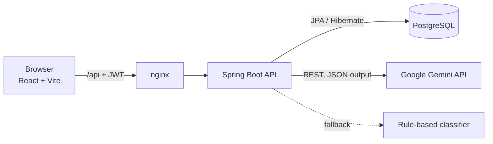
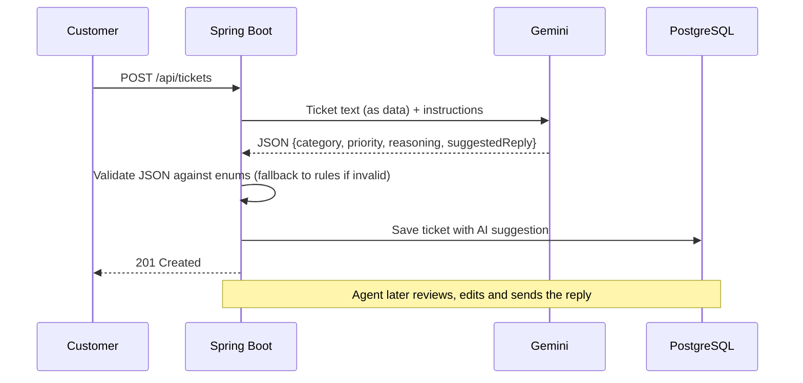

# SupportDesk: Smart Support Ticket System


A full-stack help-desk application where customers raise support tickets and agents resolve them.
When a ticket is created, an **LLM (Google Gemini) automatically classifies its category and priority
and drafts a first reply**. Agents review, edit and send it, so a human always stays in control.

> **Live demo:** _add your deployed link here_
> **Demo logins:** `customer@demo.com / Customer@123` · `agent@demo.com / Agent@123` · `admin@demo.com / Admin@123`

<!-- Add 2–3 screenshots here: ticket list, ticket detail with AI panel, admin dashboard -->

---

## Features

**Customers**
- Register, log in, raise tickets and follow the conversation
- Confirm a fix or reopen a ticket if the problem comes back

**Agents**
- See all tickets with search, filters and pagination
- AI-suggested category, priority and reasoning on every ticket
- One-click AI first reply, or a fresh AI draft based on the whole conversation
- Internal notes hidden from customers
- Assign tickets and move them through the workflow

**Admins**
- Everything agents can do, plus user management (roles, activate/deactivate)
- Dashboard with ticket breakdowns and an **AI agreement rate**: how often agents kept the AI's suggestion

**Engineering**
- Stateless JWT authentication with role-based access (`CUSTOMER`, `AGENT`, `ADMIN`)
- Enforced ticket workflow: `OPEN → IN_PROGRESS → RESOLVED → CLOSED` (with reopen)
- Graceful AI fallback: if Gemini is unavailable, an offline keyword classifier takes over
- Global error handling with consistent JSON errors and field-level validation messages
- Unit and integration tests (MockMvc + H2), run on every push by GitHub Actions
- Dockerised: the whole stack starts with one command

---

## Architecture



**How AI triage works**



---

## Tech stack

| Layer    | Technology |
|----------|-----------|
| Backend  | Java 21, Spring Boot 3.5, Spring Security, Spring Data JPA, Bean Validation, JJWT |
| AI       | Google Gemini API via Spring `RestClient`, with a rule-based fallback |
| Database | PostgreSQL 16 (H2 in-memory for tests) |
| Frontend | React 18, React Router, Vite, plain CSS |
| DevOps   | Docker, Docker Compose, nginx, GitHub Actions |
| Testing  | JUnit 5, AssertJ, MockMvc, Spring Security Test |

---

## Run it locally

### Option 1: Docker (easiest)

```bash
cp .env.example .env        # then add your GEMINI_API_KEY (optional)
docker compose up --build
```

Open http://localhost:3000 and use a demo login.

### Option 2: Run each part yourself

Requirements: Java 21, Maven, Node 20, and PostgreSQL (or just run `docker compose up db`).

```bash
# 1. Database
docker compose up -d db

# 2. Backend (http://localhost:8080)
cd backend
export GEMINI_API_KEY=your-key    # Windows PowerShell: $env:GEMINI_API_KEY="your-key"
mvn spring-boot:run

# 3. Frontend (http://localhost:5173)
cd frontend
npm install
npm run dev
```

No Gemini key? The app still works: it uses the offline keyword classifier and labels suggestions as "Keyword rules".

### Run the tests

```bash
cd backend
mvn test
```

---

## API overview

| Method | Endpoint | Who | Description |
|--------|----------|-----|-------------|
| POST | `/api/auth/register` | Public | Create a customer account |
| POST | `/api/auth/login` | Public | Get a JWT |
| GET | `/api/users/me` | Any | Current user |
| GET | `/api/tickets` | Any | List tickets (customers see their own). Filters: `status`, `priority`, `category`, `assignedToMe`, `q`, `page`, `size` |
| POST | `/api/tickets` | Any | Create a ticket (AI triage runs here) |
| GET | `/api/tickets/{id}` | Any | Ticket with conversation |
| PATCH | `/api/tickets/{id}/status` | Any* | Change status (*customers: limited moves) |
| PATCH | `/api/tickets/{id}` | Agent, Admin | Change priority, category, assignee |
| POST | `/api/tickets/{id}/assign-to-me` | Agent, Admin | Take ownership |
| POST | `/api/tickets/{id}/comments` | Any | Reply or internal note |
| POST | `/api/tickets/{id}/ai/draft-reply` | Agent, Admin | AI draft from the conversation |
| GET | `/api/admin/users` | Admin | List users |
| PATCH | `/api/admin/users/{id}` | Admin | Change role or active status |
| GET | `/api/admin/stats` | Admin | Dashboard numbers |

---

## Project structure

```
backend/src/main/java/com/supportdesk/
├── auth/       register & login
├── security/   JWT service, JWT filter, user details
├── config/     security rules, typed settings, demo data
├── user/       user entity, roles
├── ticket/     ticket & comment entities, workflow, service, controller
├── ai/         Gemini client, rule-based fallback, AI facade
├── admin/      user management & stats
└── common/     error handling, pagination
frontend/src/
├── api/        fetch wrapper
├── auth/       login state (React context)
├── components/ layout, badges
└── pages/      login, register, list, detail, admin
```

---

## What I'd add next

- Database migrations with Flyway instead of `ddl-auto=update`
- Email notifications when a ticket is updated
- SLA timers (e.g. urgent tickets must get a reply within 1 hour)
- Kubernetes manifests and deployment to a cloud provider
- RAG over a help-centre knowledge base so AI replies can cite real articles

---

## Author

**YOUR NAME** · [LinkedIn](https://www.linkedin.com/in/YOUR_LINKEDIN) · [GitHub](https://github.com/YOUR_GITHUB_USERNAME)
